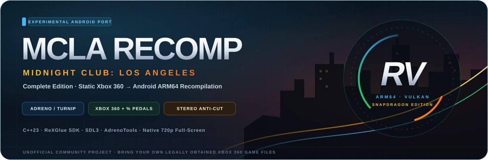
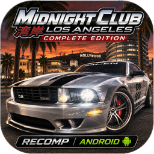

  

  

<h3 align="center">Midnight Club: Los Angeles Complete Edition — Android ARM64 Source</h3>

  Static PowerPC → C++23 Recompilation &nbsp;•&nbsp; Patched ReXGlue SDK &nbsp;•&nbsp; Adreno / Turnip Vulkan &nbsp;•&nbsp; Xbox 360 Touch HUD + Analog <code>%</code> Pedals

  
  
  
  
  

  
  &nbsp;
  
  &nbsp;
  

  <a href="#architecture">v0.1.64 Highlights</a> &nbsp;•&nbsp;
  <a href="#quick-start">Player Setup</a> &nbsp;•&nbsp;
  <a href="#compatibility">Device Matrix</a> &nbsp;•&nbsp;
  <a href="#documentation">Build &amp; Docs</a> &nbsp;•&nbsp;
  <a href="CHANGELOG.md">Changelog</a>

Maintainer: <a href="https://github.com/gabrielbskk"><strong>gabrielbskk</strong></a> &nbsp;·&nbsp; Discord: <code>gabrielbskk</code>

---

> [!NOTE]
> **Active source repository (`v0.1.64` Experimental).** Contains the Android Java launcher/HUD (`android/`), C++23 host hooks (`src/`), ordered ReXGlue SDK patch series (`patches/`), and reproducible Termux / NDK r30 build scripts (`scripts/`). No game binaries, extracted assets, generated guest C++, or signing keys are tracked in Git.

> [!IMPORTANT]
> **Legally obtained Xbox 360 game files are required** both to run `rexglue codegen` during native compilation and to import into app-private storage on Android.

## 01 · `v0.1.64` Engineering Highlights *(Experimental)*

| Subsystem | Key Changes |
| :--- | :--- |
| **Snapdragon Profiles & `mcla_empty_streets`** | `android/MclaRuntimeProfiles.java` + `src/perf_options.cpp` introduce `s23_balanced` *(default)*, `max_fps`, and `console` presets plus `mcla_empty_streets` to shed costly Xbox 360 cascades/blurs and ambient traffic under Turnip `TU_DEBUG=syncdraw`. |
| **Qualcomm `VKDBGUTILWARN003` Fix** | `patches/rexglue-android-vulkan-debug-audio.patch` disables `VK_EXT_debug_utils` on Android unless validation or `vulkan_log_debug_messages` is requested, eliminating 1,000+ driver debug callbacks/sec on Qualcomm System Vulkan. |
| **Anti-Cut Stereo Audio Engine** | Adds POSIX/Android `setpriority` elevation + `CLOCK_THREAD_CPUTIME_ID` stats in `audio_thread.cpp`, unlocks `SDLAudioDriver::frames_mutex_` before 6ch → 2ch downmix and `SDL_PutAudioStreamData`, and adds `s23_adaptive` (`16–28`) & `redmagic_safe` (`20–32`, `1024` sample frames) profiles. |
| **Midnight Launcher, App Icon & `%` Pedals** | Adaptive/mipmap `@mipmap/ic_launcher` packaged from the cover art; redesigned `MclaLauncherActivity`, `MclaTouchControls` (authentic Xbox 360 jewel buttons + 4-dot concave sticks + vertical `GAS`/`BRK` pedals with zero-GC `0%–100%` gauge), and `MclaTouchEditorActivity`. |
| **Self-Healing Log Recorder** | `android/MclaLogExporter.java` exports every 15s during gameplay + lifecycle transitions to `Documents/MCLA/logs/MCLA-diagnostic.txt` and `mcla-current.txt`, automatically recovering deleted `MediaStore` rows. |

## 02 · Build & Run Overview

- **Build from source (NDK r30 or Termux):** Follow the pinned 14-patch ReXGlue SDK (`f5337cdc947ff6d4c4196737e2c807a48f2a1fc2`) + host CMake + `scripts/build_android_apk.sh` workflow in [docs/android-build.md](docs/android-build.md).
- **Install & import on Android:** Use `pm install -r` to preserve `files/game/` and career saves across upgrades; import the 13 extracted game files (~6.2 GB) as documented in [docs/android-testing.md](docs/android-testing.md).
- **Mali / Immortalis / PanVK:** Outside supported scope; see [docs/android-mali-driver.md](docs/android-mali-driver.md).

## 03 · Multi-Device Investigation Summary

| Device & SoC | RAM | Technical Summary |
| :--- | :--- | :--- |
| **Galaxy S23** · Snapdragon 8 Gen 2 (`Adreno 740`) | 8 GB | Primary validation target (`Turnip syncdraw` + `s23_balanced` / `empty_streets` + `s23_adaptive` stereo audio). |
| **RedMagic 11 Air** · Snapdragon 8 Elite (`Adreno 830`) | 12–16 GB | Auto-selects `redmagic_safe` (`20–32` adaptive queue, `1024` AAudio buffer) + elevated host audio threads + lock-free SDL callback. |
| **Asus Zenfone 9** · Snapdragon 8+ Gen 1 (`Adreno 730`) | 6–8 GB | Resolved severe `VKDBGUTILWARN003` callback/log storm on Qualcomm System Vulkan (`225 MB` log trace). |
| **Motorola Moto G34 5G** · Snapdragon 695 (`Adreno 619`) | 4 GB | Hardware-limited (`3.4 GB` usable RAM swap thrashing + Vulkan `1.1`); **8 GB+ RAM & Adreno 7xx/8xx recommended**. |

## 04 · Documentation

| Player & Release Docs | Engineering & CI Docs |
| :--- | :--- |
| [Installation & Testing](docs/android-testing.md) | [Build from Source](docs/android-build.md) |
| [Compatibility & Performance](docs/android-compatibility.md) | [Patched SDK Source Notes](docs/android-sdk-source.md) |
| [Release Notes & Hashes](docs/android-release.md) | [Android Port Status](docs/android-status.md) |
| [Known Issues](KNOWN-ISSUES.md) | [Mali Retirement Note](docs/android-mali-driver.md) |
| [Experimental Changelog](CHANGELOG.md) | [Security Policy](SECURITY.md) |

## License & Credits

Built on [holdmysocks/mcla-recomp](https://github.com/holdmysocks/mcla-recomp), the [RenanQueiroz fork](https://github.com/RenanQueiroz/mcla-recomp), ReXGlue, SDL3, and AdrenoTools. Licensed under [GPL-3.0-or-later](LICENSE).

[Credits](CREDITS.md) &nbsp;·&nbsp; [Third-Party Notices](THIRD-PARTY-NOTICES.md)

<strong>Full Project Cover Artwork</strong>

  

---

  Unofficial community recompilation. Not affiliated with Rockstar Games or the game's rights holders. 
  <a href="#top">Back to top ↑</a>

